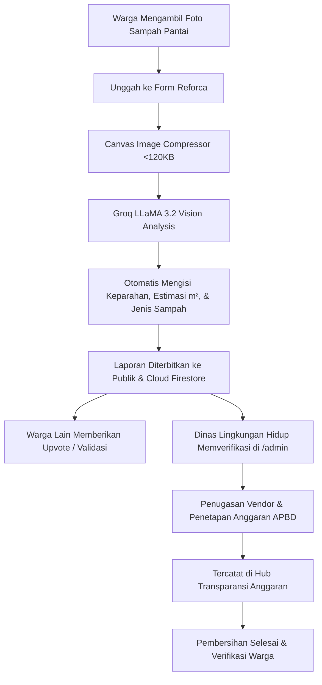

# 🌊 Reforca (Report For Care)
> **Platform Aksi Kolaboratif, Pemindaian Cerdas AI Vision, & Transparansi Anggaran Restorasi Pesisir Indonesia.**

[](https://react.dev/)
[](https://vitejs.dev/)
[](https://tailwindcss.com/)
[](https://leafletjs.com/)
[](https://firebase.google.com/)
[](https://groq.com/)
[](LICENSE)

---

## 📌 Tentang Reforca

**Reforca** adalah platform terintegrasi yang menghubungkan partisipasi aktif warga pesisir dengan otoritas pemerintah (Dinas Lingkungan Hidup) serta vendor restorasi laut. Platform ini menghadirkan transparansi penuh atas aliran anggaran publik, percepatan respon tanggap darurat sampah pesisir, serta validasi otomatis berbasis kecerdasan buatan (*AI Computer Vision*).

### 🎯 Visi & Misi Utama
1. **Partisipasi Warga Terbuka**: Memberikan sarana pelaporan titik timbulan sampah pesisir secara mudah, cepat, dan presisi.
2. **Kecerdasan Buatan (AI Vision)**: Mengidentifikasi tingkat kedaruratan, estimasi volume sebaran sampah ($m^2$), dan jenis polutan dalam hitungan detik.
3. **Akuntabilitas & Transparansi Anggaran**: Membuka data alokasi dana APBD/CSR per proyek restorasi pantai secara gamblang kepada publik guna mencegah korupsi atau manipulasi laporan.
4. **Ruang Komando Terpadu**: Menyediakan portal terpusat bagi pemerintah untuk menugaskan vendor berlisensi dan memperbarui linimasa penanganan.

---

## ✨ Fitur Unggulan

| Fitur | Deskripsi |
| :--- | :--- |
| 🤖 **AI Vision Waste Diagnostic** | Pemindaian foto pesisir otomatis ditenagai model **Groq LLaMA 3.2 11B Vision** untuk mendeteksi volume, jenis limbah (mikro/makro plastik, jaring hantu, styrofoam), dan langkah rekomendasi penanganan. |
| 🗺️ **Peta Sebaran Titik Kritis GIS** | Peta interaktif berbasis **Leaflet** dengan pin geospasial real-time, filter urgensi (*Darurat, Tinggi, Sedang, Rendah*), serta navigasi titik lokasi pantai. |
| 🗳️ **Citizen Upvoting & Crowd Priority** | Warga dapat memberikan dukungan suara (*upvote*) pada laporan kritis agar diprioritaskan oleh satgas dinas kebersihan. |
| 💰 **Hub Transparansi Anggaran Publik** | Publikasi terbuka alokasi anggaran, status pencairan, rincian biaya (*cost breakdown*), rekanan vendor resmi, dan log audit publik. |
| 🏛️ **Ruang Komando Instansi (`/admin`)** | Dashboard internal staf Dinas Lingkungan Hidup untuk verifikasi laporan, penugasan vendor resmi, input biaya APBD, dan pembaruan status penanganan (*Pending &rarr; In Progress &rarr; Selesai*). |
| ⚡ **Kompresi Citra Canvas Cerdas** | Kompresi foto sisi-klien (*HTML5 Canvas*) otomatis menjaga ukuran file tetap ramping (<120 KB) untuk inferensi AI super cepat dan efisiensi Cloud Firestore. |

---

## 🛠️ Arsitektur & Teknologi

- **Frontend Framework**: [React 19](https://react.dev/) + [Vite](https://vitejs.dev/)
- **Styling**: [Tailwind CSS](https://tailwindcss.com/) dengan palet warna nautika modern, animasi mikro, dan tata letak responsif
- **Pemetaan Geospasial**: [Leaflet](https://leafletjs.com/)
- **Ikonografi & Animasi**: [Lucide React](https://lucide.dev/) & [AOS (Animate on Scroll)](https://michalsnik.github.io/aos/)
- **Kecerdasan Buatan (AI)**: [Groq SDK](https://console.groq.com/) (`llama-3.2-11b-vision-preview`)
- **Backend & Database**: [Google Cloud Firebase / Firestore](https://firebase.google.com/)
- **Linter & Code Quality**: [Oxlint](https://oxc.rs/)

---

## 📂 Struktur Direktori Proyek

```text
Reforca/
├── public/                 # Aset statis publik
├── src/
│   ├── assets/             # Gambar, ilustrasi, dan ikon lokal
│   ├── components/         # Komponen React modular
│   │   ├── Navbar.jsx              # Navigasi kapsul mengambang & status login
│   │   ├── HeroSection.jsx         # Header visual pesisir dengan CTA utama
│   │   ├── ImpactStatsBar.jsx      # Metrik live dampak restorasi & sampah terkumpul
│   │   ├── FeaturesSection.jsx     # Sorotan fitur platform
│   │   ├── BeachMapSection.jsx     # Wrapper section peta GIS
│   │   ├── BeachMap.jsx            # Implementasi Leaflet Map interaktif
│   │   ├── CitizenReportsSection.jsx # Grid laporan warga dengan status & upvote
│   │   ├── TransparencyHub.jsx     # Audit transparansi anggaran APBD & vendor
│   │   ├── AdminDashboard.jsx      # Ruang Komando Dinas Lingkungan Hidup
│   │   ├── CreateReportModal.jsx   # Modal pelaporan warga & auth session
│   │   ├── PublicReportForm.jsx    # Form input laporan & AI Vision Scanner
│   │   ├── FAQSection.jsx          # Tanya jawab seputar platform & aksi bersih
│   │   ├── ContactSection.jsx      # Formulir kontak & kanal pelaporan darurat
│   │   └── Footer.jsx              # Footer navigasi & hak cipta
│   ├── data/
│   │   └── mockFirestore.js        # Data benih pesisir & utilitas format Rupiah
│   ├── lib/
│   │   └── firebase.js             # Inisialisasi Firebase & koneksi Firestore
│   ├── services/
│   │   ├── groqVision.js           # Inferensi Groq LLaMA 3.2 Vision API
│   │   └── reportService.js        # Firestore Realtime CRUD & listener subscription
│   ├── utils/
│   │   └── imageHelper.js          # Utilitas kompresi gambar berbasis HTML5 Canvas
│   ├── App.jsx                     # Root application & routing logika
│   ├── main.jsx                    # Vite React entry point
│   └── index.css                   # Tailwind directives & kustom utilitas
├── .env.example            # Contoh konfigurasi environment variables
├── tailwind.config.js      # Konfigurasi tema Tailwind
├── vite.config.js          # Konfigurasi bundler Vite
└── package.json            # Daftar dependensi & npm scripts
```

---

## 🚀 Panduan Memulai Cepat

### 1. Prasyarat Sistem
- **Node.js**: Versi `18.x` atau yang lebih baru
- **NPM**: Versi `9.x` atau yang lebih baru

### 2. Kloning Repositori
```bash
git clone https://github.com/Mie-Yamin/Reforca.git
cd Reforca
```

### 3. Instal Dependensi
```bash
npm install
```

### 4. Konfigurasi Environment Variables
Salin file `.env.example` menjadi `.env.local`:
```bash
cp .env.example .env.local
```

Isi variabel konfigurasi di dalam file `.env.local`:
```env
# Konfigurasi Google Cloud Firebase
VITE_FIREBASE_API_KEY="AIzaSy..."
VITE_FIREBASE_AUTH_DOMAIN="reforca-apps.firebaseapp.com"
VITE_FIREBASE_PROJECT_ID="reforca-apps"
VITE_FIREBASE_STORAGE_BUCKET="reforca-apps.firebasestorage.app"
VITE_FIREBASE_MESSAGING_SENDER_ID="636611095333"
VITE_FIREBASE_APP_ID="1:636611095333:web:..."

# Konfigurasi Groq Cloud Vision AI
VITE_GROQ_API_KEY="gsk_..."

# Autentikasi Ruang Komando Admin (/admin)
# Whitelist email admin (dapat diisi lebih dari satu email, dipisahkan koma)
VITE_ADMIN_EMAILS="admin@reforca.id"
VITE_ADMIN_PASSWORD="adminreforca2026"
```

> 💡 *Catatan: Halaman Ruang Komando (`/admin`) diproteksi dengan verifikasi whitelist email. Hanya email yang terdaftar di `VITE_ADMIN_EMAILS` yang dapat masuk ke dashboard instansi Dinas Lingkungan Hidup.*

### 5. Jalankan Server Pengembangan
```bash
npm run dev
```
Buka browser pada alamat: `http://localhost:5173`

---

## 📜 Perintah yang Tersedia (NPM Scripts)

| Perintah | Deskripsi |
| :--- | :--- |
| `npm run dev` | Menjalankan local development server dengan Hot Module Replacement (HMR). |
| `npm run build` | Melakukan proses bundling produksi ke dalam direktori `dist/`. |
| `npm run preview` | Menjalankan preview lokal dari hasil build produksi. |
| `npm run lint` | Menjalankan pemeriksaan kode cepat menggunakan Oxlint. |

---

## 🔒 Alur Pelaporan & Verifikasi Transparansi



---

## 🤝 Kontribusi

Kontribusi selalu disambut dengan hangat! Jika Anda ingin menambahkan fitur baru, memperbaiki bug, atau memperluas data pesisir:
1. *Fork* repositori ini.
2. Buat branch fitur baru (`git checkout -b fitur/fitur-keren-anda`).
3. Lakukan commit perubahan Anda (`git commit -m 'Menambahkan fitur keren'`).
4. *Push* ke branch Anda (`git push origin fitur/fitur-keren-anda`).
5. Buat sebuah *Pull Request* baru.

---

## 📄 Lisensi

Proyek ini didistribusikan di bawah lisensi **MIT**. Silakan gunakan dan kembangkan untuk kelestarian laut dan pesisir Indonesia! 🌊🇮🇩
